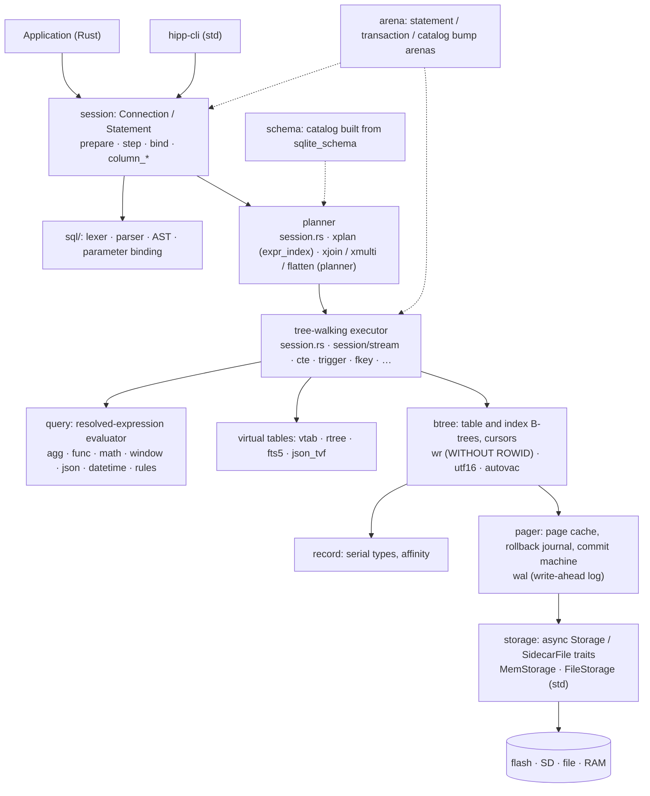

# Architecture

How hipp is put together. The design rationale is in [`SPEC.md`](SPEC.md)
(the original design foundation) and the [ADRs](adr). This page describes
the code as it stands.

## Layers

A statement goes **SQL text → tokens → AST → resolved plan → executor**,
which pulls rows from B-tree cursors through the pager, and the pager reads
and writes pages through the caller's `Storage`.

## Modules

| module | role | feature |
|---|---|---|
| `arena` | scoped bump arenas with hard maxima. Exhaustion is an error, not an abort. The only `unsafe` in the engine (a bounded exception, SPEC §6). | core |
| `storage` | the async `Storage` / `SidecarFile` traits, `MemStorage`, `FileStorage`, `block_on` | core (`FileStorage`: `std`) |
| `pager` | the page pool, the rollback-journal protocol, the resumable commit machine, hot-journal recovery | core |
| `wal` | the write-ahead log: frames, checksums, the heap wal-index, checkpoints | `wal` |
| `btree` | table and index B-trees: search, insert, delete, balance, overflow chains, the freelist, cursors | core |
| `wr` | WITHOUT ROWID tables, as clustered index B-trees behind the rowid-shaped B-tree interface | `without_rowid` |
| `utf16` | UTF-16 text conversion and record translation at the B-tree boundary | `utf16` |
| `autovac` | auto-vacuum pointer maps and page moves | `autovacuum` |
| `record` | the record format (serial types, varints), `Value` / `OwnedValue`, affinity | core |
| `schema` | the catalog read from `sqlite_schema`: tables, indexes, views, triggers | core |
| `sql` | lexer, parser and AST (`sql/parser.rs` holds the tiny grammar and the full one), parameter binding (`sql/bind`), the trigger NEW. / OLD. binder (`sql/trig`) | core |
| `session` | `Connection` / `Statement`, planning and the tree-walking executor | core |
| `session/stream` | streamed top-level queries, which hold no source rows | `sql` |
| `session/pragma` | the PRAGMA statements and the integrity check | `sql` |
| `session/cte` | view and CTE expansion, the recursive-CTE queue | `sql` |
| `session/maint` | savepoints, VACUUM, REINDEX, ANALYZE | `sql` |
| `session/alter`, `session/temp` | ALTER TABLE, the TEMP database | `sql` |
| `session/trigger`, `session/fkey` | trigger programs, foreign-key actions and checks | `triggers`, `foreign_keys` |
| `session/xindex` | the access planner for expression / partial indexes | `expr_index` |
| `session/join`, `session/flatten` | the join planner (path solver, automatic indexes, Bloom filters, stat1), the subquery flattener, push-down | `planner` |
| `xplan`, `xmulti`, `xjoin` | index strategies: single-table loops, MULTI-INDEX OR, skip-scans, min / max, join loops | `expr_index`, `planner` |
| `session/eqp` | EXPLAIN QUERY PLAN | `explain` |
| `session/attach` | ATTACH / DETACH, cross-database statements, the super-journal | `attach` |
| `session/vtab`, `vtab` | the virtual-table module abstraction, `generate_series`, `dbstat` | `vtab` |
| `session/json_tvf` | `json_each` / `json_tree` | `json` |
| `rtree`, `session/rtree` | the R*Tree module | `rtree` |
| `fts5/`, `session/fts5` | FTS5: tokenizers, the query language, segments, merges, `bm25` / `highlight` / `snippet`. `fts5/sdel` holds tombstones and secure-delete. | `fts5`, `fts5_delete` |
| `query` | the resolved-expression evaluator: operators, CAST, CASE, comparison and collation rules | `query` |
| `agg` | aggregate folding: SQLite's sum / avg rules, the percentile family, aggregate ORDER BY and DISTINCT | `query` |
| `func` | `printf` and the scalar function library | `sql` |
| `math` | correctly rounded math functions (no libm) | `math` |
| `window` | window functions on SQLite's frame engine | `window` |
| `json` | JSON and JSONB | `json` |
| `datetime` | a model of SQLite's `date.c` | `datetime` |
| `rules` | CHECK, generated-column, STRICT and DEFAULT rules | `query` |
| `systime` | the host clock and time zone | `std` |
| `error` | the remedy-named error enums | core |
| `vm` | an experimental register VM (ADR 0005 / 0007). It is hidden, in no profile, and frozen: it measured larger than the tree executor in every profile. | `vm` (hidden) |
| `bin/hipp_thumb_demo` | the bare-metal program the size gates measure | — |

`hipp-cli/` is a separate crate: the `sqlite3`-compatible shell.

## Key decisions

- **Async storage, no runtime** (SPEC §5.1, decision D2). The I/O surface is
  `async fn`, and all durable progress lives in state machines stored in the
  `Connection` / `Statement`, so every future can be dropped at an await point
  (see the [guide §9](GUIDE.md#9-async-executors-cancellation-threads)).
- **Arenas, not a general heap discipline** (SPEC §7.5). Three scopes
  (statement, transaction, catalog), each with an initial size and a hard
  maximum the caller sets.
- **A tree-walking executor.** A bytecode VM was built and measured (ADR 0005,
  ADR 0007). It was larger in every profile, so it stays frozen behind a
  hidden feature.
- **Features name capabilities** (ADR 0006), grouped into size-gated
  profiles (ADR 0001–0004). A build without a feature refuses what the
  feature would add, and never misreads it.
- **SQLite parity is checked differentially** against a pinned 3.54.1
  oracle (decision D1). A silent wrong answer is fixed in every profile,
  ungated (ADR 0001).
- **No C ABI** (decision D3).

## Tests

| where | what |
|---|---|
| `src/**` unit tests | per-module tests, run in every profile by CI |
| `tests/*.rs` | integration and differential tests against the pinned `sqlite3` (`tests/common`), one file per unit of work (`*_v16.rs`, `*_v17.rs`) |
| `tests/gates.rs`, `tests/size_v17.rs` | the RAM and allocation gates |
| `tests/crash.rs` | crash injection at every write of a commit, plus real SQLite recovering hipp's journals |
| `hipp-cli/tests/` | the CLI diffed byte for byte against the `sqlite3` shell |
| `examples/` | the profile examples, run in every profile by `ci/run-examples.sh` |
| miri (CI) | the arena's `unsafe` and an end-to-end engine run |
